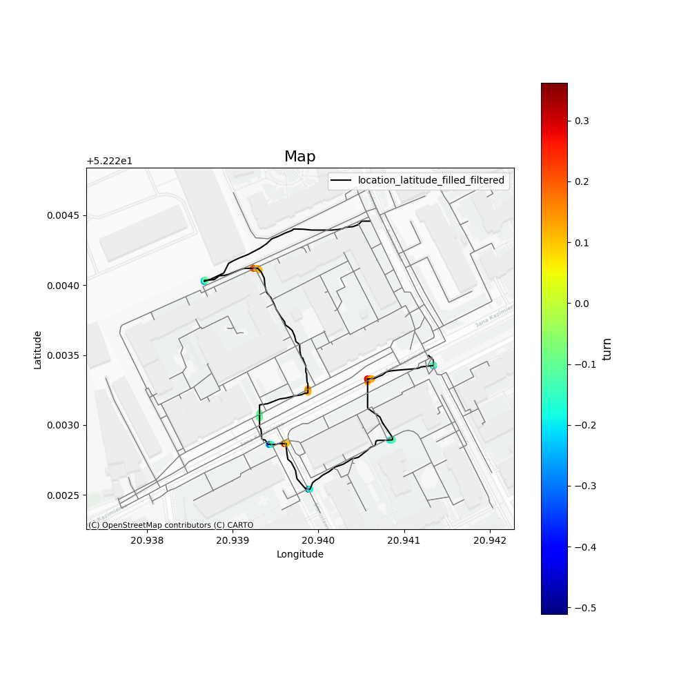

# BicycleTurnDetection
Detection of turns and their sensitivity using IMU sensor from the phone.

# How it's done
Calculation of first derivative of orientation, and activation if the value is above treshold.

# Result

